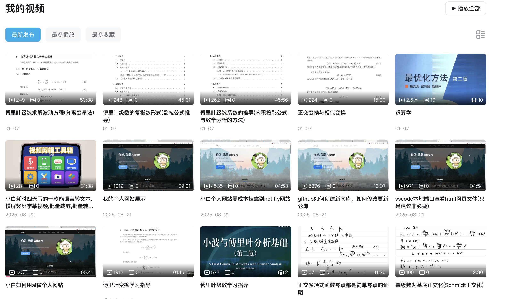

# bili-core

Bilibili UP 主视频列表抓取、元数据导出与音视频下载 CLI 工具。工作流程分为两部分：先按 UP 主 UID 或名称抓取账号全部视频，导出包含分 P、统计数据和合集信息的完整 JSON，以及便于表格筛选的简版 CSV；再根据登录账号具备的权限下载所选视频或音频，大会员账号可获取 Hi-Res FLAC、Dolby Atmos、4K/8K 等高质量 DASH 流。

## 功能

- **Hi-Res FLAC 无损音频下载** — 需大会员，获取 DASH FLAC 音轨
- **Dolby Atmos EAC3 / AC-3 音频下载** — 需大会员，获取杜比全景声/杜比数字音轨
- **AAC 标准音频下载** — 登录即可，获取 192K 标准音频
- **最高画质视频下载** — 需大会员，自动选择最高分辨率 DASH 视频流（含 4K、8K）
- **视频+音频 ffmpeg 无损合并** — 下载后自动合并（FLAC 音频合入 MKV，其余合入 MP4）
- **批量下载** — 按 UP 主 UID 批量下载视频
- **视频元数据导出** — 导出 UP 主全部视频信息到 JSON（包含分P、播放量、点赞、投币、收藏及合集信息等）
- **按关键词批量下载脚本** — `scripts/download-artist.mjs` 支持按标题关键词筛选下载，并发+跳过已有
- **白名单批量同步** — `sync` 命令根据白名单文件批量导出多个 UP 主视频元数据（JSON + CSV）

## 来源、许可证与免责声明

本项目以 **GNU Affero General Public License v3.0 or later（AGPL-3.0-or-later）** 开源。任何人都可以使用、研究、修改和再分发本项目，也可以在遵守许可证的前提下用于商业场景；向他人分发本项目或修改版时，必须依照 AGPL 提供对应源码。若修改后作为网络服务供用户交互，也必须向这些用户提供正在运行版本的对应源码。转载、修改和分发时还应保留版权、许可证及第三方来源说明。完整条款见 [`LICENSE`](LICENSE)。

本项目维护者仅以非商业目的开发、研究和公开本项目源码，不通过本项目提供收费下载、数据出售或其他商业化服务。项目在使用者本地运行，维护者不参与、不控制，也不代表 Bilibili 或任何第三方对本项目的下载、修改、部署或使用；第三方实施的行为属于其独立行为，相应责任由实施者依法自行承担。

本项目的下载相关实现并非 Bilibili 官方 SDK。下载部分的整体实现思路与接口处理方式，包括 WBI 请求签名、视频信息与播放地址接口调用、DASH 音视频流选择、分 P 处理、音视频下载及 FFmpeg 合并，参考了浏览器用户脚本项目 [Bilibili-Evolved](https://github.com/the1812/Bilibili-Evolved) 的[“下载视频”组件](https://github.com/the1812/Bilibili-Evolved/tree/master/registry/lib/components/video/download)及相关实现。`bili-core` 与 Bilibili-Evolved 没有隶属、授权或官方合作关系。第三方来源及许可证说明见 [`THIRD_PARTY_NOTICES.md`](THIRD_PARTY_NOTICES.md)。

本项目仅供学习、研究和技术参考。该表述说明项目定位，不构成对 AGPL 已授予权利的额外用途限制。使用者应自行确认账号权限和内容权利，遵守 Bilibili 用户协议、版权、所在地区法律法规及其他适用要求；不得将本项目用于侵犯版权、绕过访问控制、规避平台风控或其他违法用途。

本软件按“现状”提供，不附带任何明示或默示担保。在适用法律允许的最大范围内，使用、修改、部署或分发本项目所产生的登录、账号限制、数据损失、合规、法律及其他风险由使用者自行判断和承担。维护者不对用户行为或由此造成的损失负责，也不排除适用法律规定的不可免责责任。

## 前置条件

- **Node.js** >= 18（ESM 模块支持）
- **Playwright Chromium** — 获取 Cookie 和 UP 主空间数据需要。安装：`npx playwright install chromium`
- **ffmpeg**（可选，视频合并需要。安装：`brew install ffmpeg`）
- **Bilibili 大会员账号**（FLAC / 4K / Dolby / Hi-Res 下载必需）

## 安装

```bash
git clone <repo-url>
cd bili-core
npm install
npm run build         # TypeScript 编译（必需，脚本依赖 dist/）
```

CLI 运行方式：

```bash
npx bili <command>        # 通过 npm bin 运行（推荐）
npm start                 # 等同于 node bin/bili.js
node bin/bili.js <command>
```

## AI Skill

项目内置 [Bili Core Skill](.agents/skills/bili-core/SKILL.md)，用于让支持 Agent Skills 的 AI 根据自然语言需求选择 CLI 或现有脚本，完成视频列表抓取、JSON/CSV 导出、关键词筛选以及音视频下载。Skill 只负责编排项目已有能力，不会为了执行普通抓取任务而修改业务代码。

在 Codex 等支持项目级 Skill 的环境中，可以显式调用：

```text
Use $bili-core to get all videos for UID <UID> and save JSON and CSV.
Use $bili-core to filter titles containing 关键词A or 关键词B, then download audio only.
Use $bili-core to download the BVIDs selected in data/selected.csv.
Use $bili-core to sync the whitelist in up-list.txt.
```

Skill 会优先调用本地 `node bin/bili.js` CLI；只有当现有 CLI 无法直接表达筛选或自选列表流程时，才组合 JSON/CSV 处理和单视频下载命令。完整路由、输入、筛选和安全规则见 [Bili Core Skill](.agents/skills/bili-core/SKILL.md)。

## 使用

### 1. 获取 Cookie

首次使用需要登录 Bilibili 获取 Cookie（需先安装 Playwright Chromium：`npx playwright install chromium`）：

```bash
npm run get-cookie
```

这会打开一个浏览器窗口，扫码登录后自动提取 Cookie 写入 `.env` 文件。

验证 Cookie 是否有效：

```bash
npx bili check-login
```

> **注意**：除 `lookup`（按名称查找 UID）外，其余命令在未登录时会自动打开浏览器引导扫码登录。`lookup` 无需 Cookie，直调 B站搜索 API。

### 2. 查找 UP 主 UID

如果不知道 UID，用名字搜索。**无需登录**，直调 B站搜索 API：

```bash
npx bili lookup <关键词>
npx bili lookup <UP主名称>
# <UID>
```

精确匹配时直接输出 UID；无精确匹配时列出候选。

拿到 UID 后传给 `list`、`export`、`batch`、`sync` 命令。这些命令也支持 `--name <名称>` 选项（`sync` 除外，它从白名单文件读取），可直接按 UP 主名称操作，跳过 `lookup` 步骤。

### 3. 查看 UP 主视频列表

```bash
npx bili list <UID>
npx bili list <UID> --limit 10                    # 只显示前 10 个
npx bili list <UID> --json                        # JSON 格式打印到终端
npx bili list --name "示例UP主" --limit 10       # 直接按名称查找，跳过 lookup
```

视频列表通过 Playwright 浏览器抓取 `x/space/wbi/arc/search` 接口获取。终端预览仅显示标题、播放量、时长等基本信息，完整元数据（点赞、投币、收藏等）请使用 `export` 命令导出。

#### 空间投稿页、本人/访客视角与合集补全

第一步抓取访问的是 UP 主个人空间的**投稿页面**：

```text
https://space.bilibili.com/{UID}/upload/video
```

项目监听该页面发出的 `x/space/wbi/arc/search` 响应并自动翻页，获取页面当前返回的 BVID。Bilibili 对同一批合集视频存在两种展示方式：

- 本人查看自己的投稿页时，多个独立投稿可能折叠成一张合集卡片；下图中的“运筹学”等卡片右下角显示合集数量。
- 登录账号查看其他 UP 主时，合集中的独立 BVID 可能全部平铺在“TA 的视频”中。
- 这只是空间页面的展示差异。合集中的 episode 仍是不同 BVID；多 P 才是同一个 BVID 下的多个 `pages`。

本人视角，合集被折叠显示：



访客视角，合集 episode 作为独立投稿平铺显示：


视频播放页仍会显示其合集归属与合集内其他独立视频：


上面前两张图就是 Playwright 实际访问的空间投稿页示例。浏览器以无头模式运行，所以运行时不会弹出窗口；截图用于解释 Bilibili 页面在本人视角和访客视角下可能出现的不同形态，不参与数据解析。项目不会靠识别卡片图片、角标或页面文字来推断合集。

#### 实现流程：浏览器抓入口，详情接口补全结构

```mermaid
flowchart TD
    A[export / sync 接收 UP 主 UID] --> B[Playwright 启动无头 Chromium 并注入登录 Cookie]
    B --> C[访问 /{UID}/upload/video 投稿页]
    C --> D[监听 arc/search 响应并点击“下一页”]
    D --> E[得到空间当前视角返回的初始 BVID 列表]
    E --> F[逐个请求 x/web-interface/view?bvid=...]
    F --> G[读取 pages：补全同一 BVID 的 P1 到 PN]
    F --> H[读取 ugc_season.sections.episodes：补全合集结构]
    H --> I{episode BVID 是否已在 videos 中}
    I -- 是 --> J[写入合集 ID、名称、顺序和总数]
    I -- 否 --> K[再请求该 episode 的 view 详情]
    K --> J
    G --> L[写入每个分 P 的 CID 和原始标题]
    J --> M[生成完整 JSON]
    L --> M
    M --> N[从 JSON 视频记录生成平铺 CSV 摘要]
```

具体分为三部分：

1. **空间入口使用浏览器自动化。** `src/scraper.ts` 启动 Playwright Chromium、注入项目 Cookie、访问 `https://space.bilibili.com/{UID}/upload/video`，监听页面发出的 `x/space/wbi/arc/search` 响应，并点击“下一页”直到空间接口声明的最后一页。这里得到的是当前登录账号所见视角下的初始 BVID 列表和 UP 主昵称。
2. **单独视频的多 P 使用详情接口补全，不使用浏览器自动化。** `src/export.ts` 对每个 BVID 直接请求 `x/web-interface/view?bvid={BVID}`。响应中的 `pages[]` 已包含该视频全部分 P；项目按接口数组顺序保存每项的 `cid` 和 `part`，数组下标 `0` 对应 P1，`1` 对应 P2。因而无需尝试 `?p=2、3、4...` 直到报错，也不会受多 P 未显示在空间主页的影响。
3. **本人视角中被折叠的合集视频也使用详情接口补全。** 任一合集 episode 的详情响应会携带 `ugc_season`。项目解析 `sections[].episodes[]` 得到合集中的全部独立 BVID、分组和顺序，然后把空间初始列表中缺少的 episode BVID 再次送入 `x/web-interface/view` 获取完整详情。若同一合集在不同响应中完整度不同，会保留 episode 最多的一份；个别补抓详情连续失败时，仍会用 `ugc_season` 中的 episode 摘要建立兜底记录，避免静默漏项。最后统一为每个 episode 写入 `collection.id/title/index/total`。

因此，浏览器自动化只解决“如何可靠进入空间投稿页并拿到一批起始 BVID”；多 P 数量、分 P 标题、合集成员和本人视角下被折叠的独立视频，都来自结构化接口响应。`list` 只反映第一步空间投稿接口直接返回的列表，因此数量可能受本人/访客展示方式影响；`export` 和 `sync` 才会执行完整补全。

截至 2026-09-05 的本项目实测：同一登录账号查看自己的投稿页时，`list` 返回 15 个条目，而 `export` 最终得到 25 个视频记录；其中 5 个合集包含 20 个不重复 episode，最终缺失数为 0。“tt大王放映室丨谭思慧”的访客视角平铺 129 个投稿，导出后对应两个合集（119 + 10 个 episode），同样 129 个全部写入。因此两种视角会在完整导出阶段归一为相同的“独立视频 + 合集归属 + 分 P”数据结构。

### 4. 查看视频信息

```bash
npx bili info BV1nJBLBuEWQ
npx bili info BV1nJBLBuEWQ --json          # JSON 格式输出
```

显示视频标题、UP 主、时长、分P、可用视频流（分辨率/编码/码率）和音频流（FLAC/Dolby/AAC）。

### 5. 下载

**下载单个视频（视频+音频合并）：**

```bash
npx bili download BV1nJBLBuEWQ
```

仅下载音频：

```bash
npx bili download BV1nJBLBuEWQ --audio
```

指定分P：

```bash
npx bili download BV1nJBLBuEWQ --page 2
```

#### 普通视频、多 P 与合集的链接和目录关系

多 P 使用同一个 BVID，URL 仅通过 `p` 参数指定第几个分 P：

```text
https://www.bilibili.com/video/BV1ak4X6BEeh       # 同一个视频，默认 P1
https://www.bilibili.com/video/BV1ak4X6BEeh?p=2   # 同一个视频的 P2
https://www.bilibili.com/video/BV1ak4X6BEeh?p=3   # 同一个视频的 P3
```

对应 CLI：

```bash
npx bili download BV1ak4X6BEeh --page 2
npx bili download BV1ak4X6BEeh --page 3
```

合集则由多个独立 BVID 组成；合集里的任意一个独立视频还可以再次包含多个分 P。项目 Skill/Agent 在下载完整多 P 视频或合集时，按以下层级整理现有单视频命令产生的文件：

```text
downloads/{UP主名称}/
├── {不属于合集的普通单P视频标题}.{ext}
├── {不属于合集的多P视频标题}/
│   ├── {P1原始标题}.{ext}
│   ├── {P2原始标题}.{ext}
│   └── ...
└── {合集标题}/
    ├── {合集内普通单P视频标题}.{ext}
    └── {合集内多P视频标题}/
        ├── {P1原始标题}.{ext}
        ├── {P2原始标题}.{ext}
        └── ...
```

CLI 的一次 `download` 仍只处理一个 BVID 的一个分 P；整个多 P 或合集由使用者或 Agent 根据 JSON 选择并重复调用，不额外绑定一个固定的批量下载脚本。

**批量下载 UP 主视频：**

```bash
npx bili batch <UID>                              # 默认下载前 10 个
npx bili batch <UID> --audio                      # 仅下载音频
npx bili batch <UID> --limit 50                   # 下载前 50 个
npx bili batch --name "示例UP主" --limit 20      # 按名称批量下载，跳过 lookup
```

下载的文件保存在 `downloads/{ownerName}/` 目录下。

### 6. 导出元数据

```bash
# 导出 UP 主所有视频信息到 data/{upName}/ 目录（每次全量刷新）
npx bili export <UID>
npx bili export <UID> --concurrency 10           # 并发数（默认 20）
npx bili export <UID> --delay 100                # 每批间隔毫秒（默认 50）
npx bili export --name "示例UP主"               # 按名称导出，跳过 lookup
```

`export` 是“抓取并导出一个 UP 主完整元数据”的命令，不是下载目录整理功能。它先通过 Playwright 翻页获取空间初始视频列表（同 `list`），再逐个调用视频详情 API 获取 stat、`pages` 和 `ugc_season`，并补抓空间列表中没有的合集 episode。`exportUp()` 将同一批完整数据保存为 `data/{upName}/{uid}_{保存时间}.json` 和 `.csv`。保存时间固定为北京时间，格式为 `YYYYMMDD_HHmmss_SSS`（毫秒）；同一批 JSON/CSV 使用相同文件名主体，重名时追加序号。每次运行全量抓取并新增一份快照，保留旧文件，便于新旧对比。

本次 CSV 调整只是把 CSV 生成函数集中到 `src/export.ts`，并加入 `page_count` 与合集摘要列，便于测试和复用；JSON 的合集/多 P 补全流程、`data/{upName}/` 输出路径以及下载目录规则没有因此改变。864 个视频约需 32 秒。

时间采用统一契约：JSON 中的 `created` 保留 Bilibili 返回的 Unix 秒时间戳，`updatedAt` 和 CSV 发布时间保留 UTC ISO 8601 绝对时刻；CLI 的人类可见发布日期固定转换为 `Asia/Shanghai`，不依赖运行电脑时区。下游合并程序应原样保留 `created` 并按数值排序。

时间修改可用以下命令验证；`test:time` 会分别在 `Asia/Shanghai`、`UTC`、`America/New_York` 环境中运行：

```bash
npm test
npm run test:time
```

#### 测试目录与提交策略

`test/` 是项目源码的一部分，应与代码一起提交和上传，不应加入 `.gitignore`。它保存可重复执行的行为约束，和会被重新生成、默认忽略的 `data/`、`downloads/`、`dist/` 不同。

当前测试内容：

| 测试文件 | 测试项 | 作用 |
|----------|--------|------|
| `test/time.test.mjs` | Bilibili Unix 秒时间戳固定转换为北京时间日期 | 使用跨日边界样例验证 `2026-08-28T16:30:00Z` 在北京时间应显示为 `2026-08-29`，避免程序跟随运行电脑的本地时区而把发布日期显示成前一天或后一天 |
| `test/time.test.mjs` | UTC ISO 时间保持绝对时刻 | 验证 CSV 使用 `2026-08-28T16:30:00.000Z`，避免把 UTC 数据误写成没有时区含义的本地时间 |
| `test/time.test.mjs` | 无效时间处理 | 验证 `0` 和 `NaN` 输出空字符串，避免缺失发布时间被伪装成 `1970-01-01` |
| `test/export-csv.test.mjs` | CSV 简表结构 | 验证表头、单 P 的 `page_count=1`、多 P 的数量以及合集 ID、名称、顺序和总数都写入正确列 |
| `test/export-csv.test.mjs` | CSV 特殊字符转义 | 验证标题或合集名称中的逗号、双引号和换行符合标准 CSV 转义，避免 Excel、Numbers 或解析脚本发生错列 |

时间测试对本项目有实际作用。Bilibili 的 `created` 是 Unix 秒时间戳，本身代表唯一绝对时刻；但 CLI 需要显示北京时间日期，CSV 又需要保存 UTC ISO 时间。如果直接使用电脑默认时区，同一份导出在澳门、UTC 或美国环境运行时可能显示不同日期。`npm run test:time` 会把同一组测试分别放在 `Asia/Shanghai`、`UTC` 和 `America/New_York` 三种系统时区下执行，确认结果不受运行环境影响。

提交前不要求把所有真实网络功能完整跑一遍。建议按风险分层：

- 默认执行 `npm test`，运行上表中的时间与 CSV 测试。测试数据使用 `BVsingle`、`BVmulti` 等虚构记录，不包含真实 UP 主、UID、Cookie 或 `data/` 导出内容，也不会向 Bilibili 发起请求。
- Playwright 登录、Bilibili 实时接口和真实媒体下载依赖账号、Cookie、网络及站点状态，适合作为发布前或相关代码变更后的人工冒烟测试，不建议放进每次默认测试，否则容易因外部环境产生偶发失败。
- 合集与多 P 的批量下载、目录整理和完成后核验由 Agent 按项目 Skill 编排，不是 core 中一个固定批量函数，因此不为这套可变流程额外添加单元测试。只有将来把它实现为正式的 core 函数或 CLI 命令时，才应同时增加对应测试。

当前规模下保留这两个测试文件即可，不需要为了追求测试数量给 Agent 流程或第三方接口写过度测试。修改时间或 CSV 时运行默认测试；涉及抓取、登录或下载链路的代码变更时，再增加一次小规模真实冒烟验证。

**CSV 列含义：**

| 列 | 含义 |
|----|------|
| `bvid` | 视频 BVID |
| `aid` | 视频 AID |
| `title` | 标题 |
| `duration` | 时长（秒） |
| `created` | 发布时间（ISO 8601） |
| `view` | 播放量 |
| `like` | 点赞数 |
| `coin` | 投币数 |
| `favorite` | 收藏数 |
| `share` | 分享数 |
| `danmaku` | 弹幕数 |
| `reply` | 评论数 |
| `page_count` | 分 P 数量；`1` 表示普通单 P 视频，`>1` 表示多 P 视频 |
| `collection_id` | 所属合集 ID；不属于合集时为空 |
| `collection_title` | 所属合集名称；不属于合集时为空 |
| `collection_index` | 当前独立视频在合集中的顺序，从 1 开始；不属于合集时为空 |
| `collection_total` | 合集包含的独立视频总数；不属于合集时为空 |
| `url` | 视频链接 |

CSV 定位为便于 Excel、Numbers 或脚本快速排序和筛选的**简版视频表**。它可以判断某行是否为多 P、是否属于合集以及在合集中的位置，但不展开每个分 P 的标题/CID，也不重复保存合集 sections、简介、封面等嵌套结构；需要精确选择某个分 P、重建下载目录或读取完整合集结构时使用 JSON。旧 CSV 不会自动增加新列，重新运行 `export` 或 `sync` 后生成新版字段。

结构列示例：

| `bvid` | `page_count` | `collection_title` | `collection_index` | `collection_total` | 判定 |
|--------|--------------|--------------------|--------------------|--------------------|------|
| `BV13ZdfYeEmZ` | 1 |  |  |  | 不属于合集的普通单 P 视频 |
| `BV1ACwLe2Ee3` | 102 |  |  |  | 不属于合集的多 P 视频 |
| `BV1GQty6WE2a` | 1 | 26年直播回放 | 119 | 119 | 合集内普通单 P 视频 |
| `BV1zyuk61E9r` | 95 | 唱歌切片 | 9 | 10 | 合集内多 P 视频 |

导出的 JSON 结构如下：

```json
{
  "upName": "UP主名称",
  "uid": 0,
  "updatedAt": "2025-07-16T...",
  "videos": {
    "BVxxx": {
      "bvid": "BVxxx",
      "aid": 123,
      "title": "视频标题",
      "cover": "https://...",
      "description": "...",
      "duration": 240,
      "created": 1700000000,
      "stat": { "view": 10000, "like": 500, "coin": 200, "favorite": 100, "share": 50, "danmaku": 30, "reply": 20 },
      "cid": 12345,
      "pages": [{ "cid": 12345, "part": "P1标题" }],
      "collection": { "id": 0, "title": "合集名称", "index": 3, "total": 26 }
    }
  },
  "collections": {
    "0": {
      "id": 0,
      "title": "合集名称",
      "cover": "https://...",
      "intro": "合集简介",
      "episodeCount": 26,
      "sections": [{
        "title": "默认分区",
        "episodes": [{
          "bvid": "BVyyy",
          "aid": 456,
          "cid": 45678,
          "title": "第 1 集",
          "cover": "https://...",
          "duration": 180,
          "created": 1700000000
        }]
      }]
    }
  }
}
```

#### JSON 字段说明

顶层字段：

| 字段 | 类型 | 含义 |
|------|------|------|
| `upName` | string | UP 主名称，用于输出目录名 |
| `uid` | number | UP 主 UID |
| `updatedAt` | string | 本次导出的时间，ISO 8601 格式 |
| `videos` | object | 视频详情表，键是 BVID，值是 `VideoEntry` |
| `collections` | object | 合集详情表，键是合集 ID（字符串形式），值是 `CollectionInfo`；没有合集时为空对象 |

`videos` 中每个视频字段：

| 字段 | 类型 | 含义 |
|------|------|------|
| `bvid` | string | 视频的 BVID，也是 `videos` 的键 |
| `aid` | number | 视频的 AV 号 |
| `title` | string | 视频标题 |
| `cover` | string | 视频封面 URL |
| `description` | string | 视频简介 |
| `duration` | number | 视频总时长，单位为秒 |
| `created` | number | 发布时间，Unix 时间戳（秒） |
| `tid` | number | Bilibili 分区 ID |
| `tname` | string | Bilibili 分区名称 |
| `stat` | object | 视频统计数据，字段见下表 |
| `cid` | number | 默认播放分 P 的 CID，通常对应 P1 |
| `pages` | array | 分 P 列表；数组顺序就是 P1 到 PN，同一个 BVID 的多个 P 都在这里 |
| `collection` | object（可选） | 所属合集的简要信息；不属于合集时省略 |

`stat` 统计字段：

| 字段 | 含义 |
|------|------|
| `view` | 播放量 |
| `like` | 点赞数 |
| `coin` | 投币数 |
| `favorite` | 收藏数 |
| `share` | 分享数 |
| `danmaku` | 弹幕数 |
| `reply` | 评论数 |

`pages` 中每项字段：

| 字段 | 类型 | 含义 |
|------|------|------|
| `cid` | number | 该分 P 的 CID，下载该 P 时使用 |
| `part` | string | 该分 P 的标题 |

`pages[0]` 对应 P1，`pages[1]` 对应 P2，以此类推。普通单 P 视频也会有一个 `pages[0]`；判断是否为多 P 应检查 `pages.length > 1`，不能根据主页卡片数量判断。

`collection` 中每项字段：

| 字段 | 类型 | 含义 |
|------|------|------|
| `id` | number | 合集 ID，对应顶层 `collections` 的键 |
| `title` | string | 合集名称 |
| `index` | number | 当前视频在合集中的顺序，从 1 开始 |
| `total` | number | 合集视频总数 |

`collections` 中每个合集字段：

| 字段 | 类型 | 含义 |
|------|------|------|
| `id` | number | 合集 ID |
| `title` | string | 合集名称 |
| `cover` | string | 合集封面 URL |
| `intro` | string | 合集简介 |
| `episodeCount` | number | Bilibili 返回的合集视频数 |
| `sections` | array | 合集分组列表 |

`sections` 中每项字段：

| 字段 | 类型 | 含义 |
|------|------|------|
| `title` | string | 合集分组名称，例如“正片”或按月份划分的分组 |
| `episodes` | array | 该分组中的独立视频列表 |

`episodes` 中每个独立视频字段：

| 字段 | 类型 | 含义 |
|------|------|------|
| `bvid` | string | 该 episode 的独立 BVID |
| `aid` | number | 该 episode 的 AID |
| `cid` | number | 该 episode 默认播放页的 CID |
| `title` | string | 独立视频标题 |
| `cover` | string | 独立视频封面 URL |
| `duration` | number | 独立视频时长，单位为秒 |
| `created` | number | 发布时间，Unix 时间戳（秒） |

合集中的每个 episode 都是独立视频 BVID，不是同一个视频的分 P。完整视频详情以顶层 `videos[episode.bvid]` 为准；`collections[].sections[].episodes[]` 用于表达合集结构和顺序。

#### JSON 结构判定示例

以下示例来自本项目的实际导出数据。为便于阅读，多 P 示例只展示数组开头几项。

普通单 P 视频：没有 `collection`，且 `pages.length === 1`。

```json
{
  "bvid": "BV13ZdfYeEmZ",
  "title": "傅里叶变换学习指导",
  "pages": [
    { "cid": 29447685362, "part": "傅里叶变换学习指导" }
  ]
}
```

不属于合集的多 P 视频：仍只有一个 BVID，但 `pages` 中有多个项目。下例实际为 102 P。

```json
{
  "bvid": "BV1ACwLe2Ee3",
  "title": "【谭思慧】全网最完整2024年抖音合集（含CGT48官抖相关）",
  "pages": [
    { "cid": 27907391554, "part": "0106" },
    { "cid": 27907391596, "part": "0107江南style" },
    { "cid": 27907391830, "part": "0111一两相思一两愁" }
  ]
}
```

属于合集的普通单 P 视频：有 `collection`，但 `pages.length === 1`。它是合集中的一个独立 BVID。

```json
{
  "bvid": "BV1GQty6WE2a",
  "title": "20260904直播回放｜谭思慧",
  "pages": [
    { "cid": 41600025608, "part": "SNH48-谭思慧9月4日的直播MSG48" }
  ],
  "collection": {
    "id": 8788627,
    "title": "26年直播回放",
    "index": 119,
    "total": 119
  }
}
```

属于合集的多 P 视频：该 BVID 同时有 `collection` 和多个 `pages`；它在合集里是一个独立 episode，内部再分成多个 P。下例实际为 95 P。

```json
{
  "bvid": "BV1zyuk61E9r",
  "title": "CGT48谭思慧 2026年7月直播唱歌切片合集",
  "pages": [
    { "cid": 40824734727, "part": "2017，你。_2026-07-01~00.34.52" },
    { "cid": 40824734938, "part": "花香_2026-07-01~00.34.52" },
    { "cid": 40824735110, "part": "神奇的糊涂魔药_2026-07-01~00.34.52" }
  ],
  "collection": {
    "id": 8807403,
    "title": "唱歌切片",
    "index": 9,
    "total": 10
  }
}
```

需要注意：JSON 是完整结构化数据；CSV 是平铺简表，只保留 `page_count` 和合集摘要列。`download <bvid> --page <N>` 仍然下载一个独立 BVID 的某个分 P，尚未提供“一次下载整个合集”的 CLI 命令。

### 7. 按关键词批量下载脚本

`scripts/download-artist.mjs` 是基于导出数据的批量下载脚本，支持按标题关键词筛选、并发控制、跳过已有文件。

> **前提**：需要先运行 `npm run build` 编译 TypeScript，脚本从 `dist/` 导入模块。

```bash
# 第一步：导出 UP 主所有视频元数据
npx bili export <UID>

# 第二步：按关键词批量下载音频
node scripts/download-artist.mjs --data data/<UID>.json  # 默认匹配“关键词”
node scripts/download-artist.mjs --keyword 其他关键词     # 匹配其他关键词
node scripts/download-artist.mjs --concurrency 3          # 并发数（默认 5）
node scripts/download-artist.mjs --delay 1000             # 批间延迟毫秒（默认 200）
node scripts/download-artist.mjs --force                  # 强制重新下载（默认跳过已有）
node scripts/download-artist.mjs --limit 10               # 限制下载数量
```

下载的音频文件保存在 `downloads/{upName}/` 目录下。

### 8. 批量同步白名单 UP 主数据

根据白名单文件批量同步多个 UP 主的视频元数据（查找 UID → 导出 JSON + CSV）：

```bash
node bin/bili.js sync <file>
node bin/bili.js sync /path/to/up-list.txt
```

白名单文件每行一个 UP 主名称，`#` 开头的行为注释。

参数：

| 参数 | 说明 | 默认值 |
|------|------|--------|
| `--concurrency <N>` | 每个 UP 主内部视频并发数 | 20 |
| `--delay <N>` | 每批间隔毫秒 | 50 |
| `--concurrency-up <N>` | 同时处理的 UP 主数量 | 3 |

流程：读取白名单 → 逐一 lookup UID → 跳过未找到的 → 并发导出视频元数据到 `data/{upName}/` 目录。

## 音频格式映射

Bilibili DASH 接口返回的音频流编码与文件扩展名对应关系：

| codecs | 编码格式 | 文件扩展名 | 说明 |
|--------|---------|-----------|------|
| `fLaC` | FLAC (Hi-Res 无损) | `.flac` | 需大会员，最高音质 |
| `mp4a.*` | AAC | `.m4a` | 标准音频，MP4 容器 |
| `ec-3` | Dolby Digital Plus (EAC3) | `.eac3` | 需大会员，杜比全景声 |
| `ac-3` | Dolby Digital (AC3) | `.ac3` | 需大会员 |

音频流选择优先级：**FLAC → Dolby EAC3 → AAC**（按音质从高到低，同级按码率降序）。

注意：`.eac3` 和 `.ac3` 文件需要播放器支持相应解码器（VLC、IINA 等可播，macOS QuickTime/Apple Music 不支持）。

## 项目结构

```
src/
├── cli.ts             # CLI 入口，commander 命令定义
├── index.ts           # 模块导出（供外部引用）
├── session.ts         # Cookie 会话管理（从 .env 加载）
├── wbi.ts             # WBI 签名算法（MD5 + mixin key）
├── scraper.ts         # Playwright 浏览器拦截 WBI 接口获取 UP 主视频列表
├── downloader.ts      # 文件下载（axios stream）+ ffmpeg 合并
├── export.ts          # 视频元数据批量导出（并发，全量刷新）
└── api/
    ├── client.ts      # Axios 客户端、登录检查、WBI 密钥获取、请求重试
    ├── playurl.ts     # 视频信息获取、DASH 流解析、音视频流选取
    ├── space.ts       # UP 主空间视频列表（Playwright 抓取）
    └── search.ts      # UP 主搜索（直调搜索 API，无需登录）

scripts/
├── get-cookie.mjs     # Playwright 浏览器登录 + Cookie 自动提取
└── download-artist.mjs # 按关键词批量下载音频（需先 build + export）

test/
├── export-csv.test.mjs # CSV 结构列与转义测试
└── time.test.mjs       # 时间格式与跨时区一致性测试

bin/
└── bili.js            # CLI 入口脚本（加载 dist/cli.js）

data/                  # 导出的元数据（data/{upName}/{uid}_{保存时间}.json + .csv）
downloads/             # 下载文件输出目录（downloads/{ownerName}/）
```

## API 说明

使用的 Bilibili 接口：

| 接口 | 用途 | 认证 |
|------|------|------|
| `x/web-interface/wbi/search/type` | 搜索 UP 主 / 视频 | 无需登录（WBI 签名） |
| `x/web-interface/nav` | 登录状态检查 + WBI 密钥获取（img_key / sub_key） | Cookie |
| `x/web-interface/view` | 视频信息（标题、分P、统计等） | Cookie（无需 WBI 签名） |
| `x/player/wbi/playurl` | DASH 音视频流地址（含 FLAC/Dolby/4K/8K） | Cookie + WBI 签名 |
| `x/space/wbi/arc/search` | UP 主空间视频列表（WBI 签名版） | Cookie + WBI 签名（Playwright 浏览器拦截） |

DASH 参数：

- `fnval=4048`：启用 DASH + HDR + 4K + 杜比音频 + 杜比视界 + 8K + AV1（Hi-Res 模式）
- `fnval=16`：仅 DASH 格式（普通模式）
- `fourk=1`：请求 4K 视频流

## 常见问题

**Cookie 过期**

运行 `npm run get-cookie` 重新登录即可。也可用 `npx bili check-login` 随时验证状态。

**ECONNRESET / ETIMEDOUT / 网络错误**

自动重试 3 次（指数退避：2s → 4s → 6s），无需人工干预。

**"啥都木有" API 错误**

BVN 对应的 CID 不匹配，Bilibili 的 CID 会变化，重新获取视频信息即可。

**UP 主视频列表获取失败**

视频列表通过 Playwright 浏览器抓取 `x/space/wbi/arc/search` 接口。确保已安装 Chromium：

```bash
npx playwright install chromium
```

**播不了 EAC3 / AC3 文件**

`.eac3`（Dolby Digital Plus）和 `.ac3`（Dolby Digital）在 macOS 上没有内置解码器。使用 VLC 或 IINA 播放，或者用 ffmpeg 转码：

```bash
# EAC3/AC3 → AAC 320k（通用）
ffmpeg -i input.eac3 -c:a aac -b:a 320k output.m4a

# 或者转为无损 FLAC
ffmpeg -i input.eac3 -c:a flac output.flac
```

**`scripts/download-artist.mjs` 报 import 错误**

该脚本从 `../dist/` 目录导入编译后的模块，请先运行 `npm run build`。

## 技术要点

- **WBI 签名**：Bilibili WBI 鉴权使用 MD5 签名，`img_key` 和 `sub_key` 从 `/x/web-interface/nav` 接口获取后通过 mixin key 表（64 位置换）混淆生成 32 位 key，对所有参数按 key 排序后拼接 query + mixin key 做 MD5
- **Promise 去重**：`checkLogin()` 和 `fetchWbiKeys()` 使用 Promise 缓存（分别有 60s 和 600s TTL），多个并发请求共享同一个 API 调用，避免重复请求
- **重试机制**：`fetchWithRetry()` 对 ECONNRESET / ETIMEDOUT / socket 错误自动重试 3 次，指数退避
- **容器 vs 编码**：DASH 音频流的 `.m4s` 文件实际是 MP4 容器（ISO Base Media），文件扩展名根据内部编码类型决定（`.flac` / `.m4a` / `.eac3` / `.ac3`）
- **ffmpeg 合并**：FLAC 音频流合并输出 MKV 容器（MP4 不支持 FLAC），其余编码输出 MP4；合并参数 `-c copy` 无损，不解码重编码
- **全量刷新**：`export` 命令每次运行都重新获取全部视频详情，JSON 和 CSV 完全覆盖，确保数据最新
- **视频列表获取**：空间视频列表通过 Playwright 浏览器访问 UP 主页，拦截 `x/space/wbi/arc/search` 响应获取完整列表，自动翻页滚动加载
